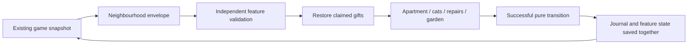

# Integrated functional checkpoint

Draft [PR 19](https://github.com/CallumHemsley/junyan/pull/19) implements all four real neighbourhood routes. Ticket 0066 remains doing: 278 genuine feature voice clips are absent, so this is not release or merge approval.

## Source and behavior

Product source `64c2031` contains the four pinned reviewed feature heads, pure saved-state integration `fe681da`, application routes `1226d50`, and gift-panel/save-test polish `4d6c95c`. It adds a one-line receipt continuation autofocus repair discovered by the full keyboard regression. It includes current maintenance main `dd3cc114b7c3151d103d0408b39e6ca305365122`, including Grandpa A, doctor, customer punctuation, cumulative earnings labels, served food, and accepted ambience.

The existing IndexedDB game snapshot carries the optional version-one neighbourhood envelope. Legacy saves initialize it; damaged feature data resets only that feature. Retained gift receipts restore apartment ownership. Real successful reducers update recovery and journal atomically; compatibility view callbacks cannot clear later recovery markers. Gifts are optional and idempotent. The restaurant alone advances the day. Leaving it stops movement and foreground audio and disables its single ambience owner; returning preserves its orders and earnings. Shared word lookup, replay, journal, DOM segmentation, and authored speech metadata remain available in every route.



## Verification and boundaries

Node 22.23.4 at exact source `b89dead`: **308/308 tests pass**, all 26 files, serialized with original assertions/timeouts. TypeScript and Vite production build pass. Existing Zod annotations produce two warnings; the integrated bundle also exceeds Vite's 500 kB warning threshold. An earlier simultaneous test/build run had three raster timeouts; the serialized suite passed. This does not establish performance on user hardware.

Before the Grandpa-only maintenance merge, **8/8 development** and **10/10 production** browser cases passed on desktop and phone. Production uses the actual `/junyan/` build and service worker. Those checks exercise normal mandatory opening, restaurant orders and four customers/change, all four routes, lookup/replay, meaningful recovery versus invalid actions, optional gifts, reload, day two, old and corrupt IndexedDB rows, offline UI/save/return, and all five genuine cached doctor clips. Independent exact-`b89dead` production desktop and phone reruns also passed the full normal-opening four-route journey without edits (42.7/40.9 seconds). The later product delta is only the receipt focus repair, separately reviewed and verified below.

The complete normal feature journey and seeded migration tests explicitly supply native PCM responses for absent namespaced clips. They prove interaction, state, cancellation, and native playback plumbing, **not feature speech or offline voice readiness**. Separate unmocked cases observe genuine missing-asset MediaError, and the production offline case uses no replacement media: cached UI/save and existing restaurant ambience work, while missing feature speech fails visibly. Browsers launch muted. Native playback validity is not an auditory or Mandarin-quality review.

Commands (existing dependencies; no frozen-install claim):

```sh
PATH=/workspace/.junyan-tools/node_modules/node/bin:$PATH pnpm --config.verify-deps-before-run=false exec vitest run --fileParallelism=false
PATH=/workspace/.junyan-tools/node_modules/node/bin:$PATH pnpm --config.verify-deps-before-run=false build
JUNYAN_BROWSER_PATH=/usr/bin/chromium pnpm --config.verify-deps-before-run=false exec playwright test e2e/neighbourhood.spec.ts e2e/neighbourhood-save.spec.ts --config playwright.neighbourhood.config.ts
JUNYAN_BROWSER_PATH=/usr/bin/chromium JUNYAN_NEIGHBOURHOOD_PREVIEW=1 pnpm --config.verify-deps-before-run=false exec playwright test e2e/neighbourhood.spec.ts e2e/neighbourhood-save.spec.ts e2e/neighbourhood-offline.spec.ts e2e/doctor-audio.spec.ts --config playwright.neighbourhood.config.ts --grep 'normal opening|old IndexedDB|corrupt feature|real cached|all five doctor'
python3 scripts/neighbourhood-audio-audit.py
```

The real asset audit deliberately exits 1: apartment 47, cats 85, repairs 64, garden 82 missing clips; zero invalid existing referenced clips. No silent or relabelled assets were added. Normal-proxy requests to pinned Hugging Face configuration/revision URLs fail CONNECT 403 at `huggingface.co` before redirects. Configuration access is unavailable. Linux synthesis remains untested; network access alone would not prove synthesis success.

## Visuals and quality limits

Desktop and phone screenshots in [integrated](integrated/) show the actual four pixel scenes. They were inspected for scene coherence, legibility, navigation, gift feedback, and overflow. Phone layouts require substantial vertical scrolling; this is a usability limitation, not horizontal overflow. Gift speech now sits in a compact paper panel using the existing segmented `apartment.gift` line. Choices include apartment arrangement, cat search, repair actions, and garden tending; completion leads to optional apartment gifts and next-day garden growth. These connect activities without new currency or clocks.

This establishes finite interactions, not sustained enjoyment or retention. Repairs repeat two jobs, garden growth caps at three, apartment finds are bounded, and cats have three routines. The maintenance review's muted baseline rated presentation 7, immersion 6, loop interest 5, usability 7.5, reliability 8, and demo proximity 6.5/10. Those are qualitative observations, not integrated ratings or listening acceptance. Further human play and audible dialogue review remain required.

The [technical capture probe](integrated/capture-probe/README.md) records the accepted 包子 word through a real browser audio graph. Its numerical waveform correlation is 0.99835. It is explicitly not actual feature gameplay, any requested feature video, independent listening review, or proof of the complete game's capture behavior. No audible feature demos or combined tour exist yet. No supported externally accessible cloud preview URL has been established; loopback port 5466 is not user access.

## Review and remaining gates

Earlier independent standalone/content and pure-state reviews are preserved in [review.md](review.md). The integrated reviewer passed published `b89dead` with no blocking code finding, then independently approved the one-line receipt focus repair and test-contract corrections. The original 72-case regression batch passed 69 and failed three: a replay fixture teardown race, plus desktop and phone assertions from the pre-0061 focus contract. Corrected tests exposed a real existing payment-to-thanks focus loss; the continuation button now receives focus when it mounts. Six targeted desktop/phone cases pass after that repair, retaining the normal pointer opening/four customers, full keyboard day, and native replay recovery. Initial failure logs and contexts are retained. These are 72 unique original cases with affected reruns, not additive unique test counts. At exact product/test commit `64c2031`, the fresh stronger keyboard cases pass on desktop and phone (31.9/34.0 seconds): continuation focus, receipt word lookup and Escape restoration, all four customers, summary and day two. The final production build passes in 2.19 seconds. The 308-test pure suite was not repeated after this single autofocus prop because pure modules did not change; its exact scope remains `b89dead`. No unresolved functional finding remains from the 72 unique original cases. Port 5466 is stopped. Generated ticket 0063 evidence was copied under this ticket and its accepted originals restored unchanged. Genuine feature voice generation, actual offline speech/listening review, four audible feature demos and combined tour, and coordinator-only conditional main merge remain incomplete. No feature main merge is authorized while those release gates fail.
