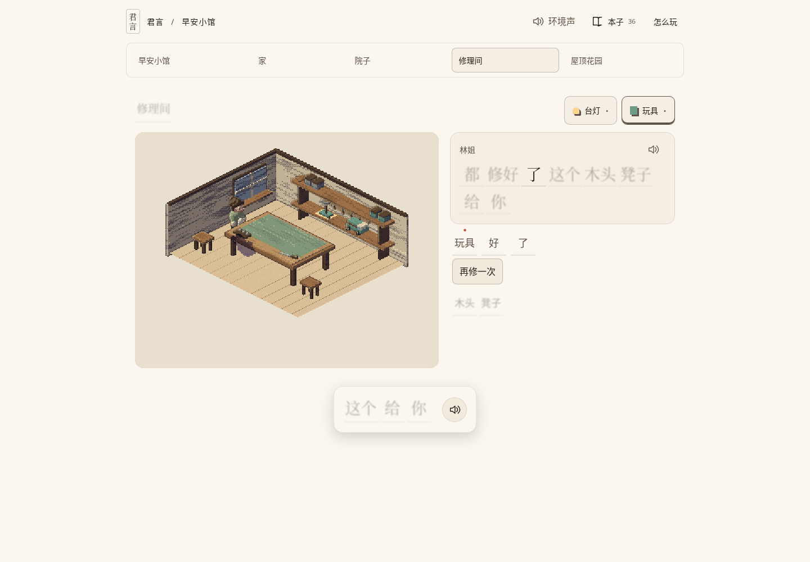
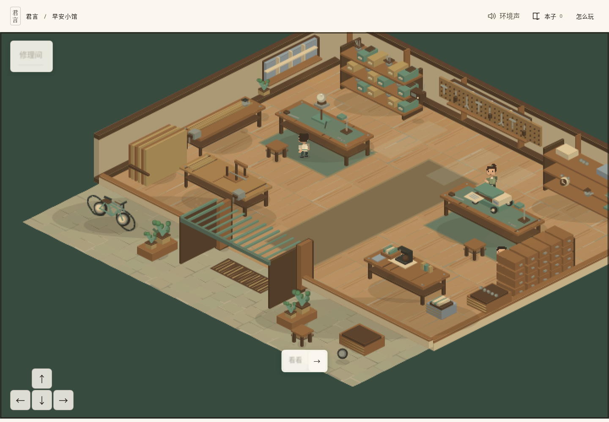

The baseline is the committed pre-world workshop screenshot from 0066, retained on main8cd5bc2. The current image is an actual production workshop approach with the player in the connected world. These captures show different gameplay states; they compare composition and reachable room design, not a pixel-identical scene.

The former is one static central bench behind place tabs. The current room has separate physical lamp/toy benches, a broad central route, window joinery, sewing, parts storage, repaired-object display and a walk-through covered entry to town. Production repair/reload and town-door proofs are linked in progress.md. The whole program and ticket remain active pending the listed acceptance gates.
