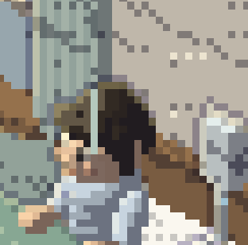

## Why

Callum reports a distracting flicker in the hospital opening and supplied the close-up below. The screenshot shows the seated patient's head beside a narrow vertical pale strip; use this area to locate the reported artifact. The ward should feel calm, with stable character and scenery rendering.

## Done when

- [x] Reproduce the reported flicker in the opening. Record the affected step, viewport and motion conditions, and capture a short before video; the supplied still alone cannot establish the temporal behavior or cause.
- [x] Identify and fix the rendering cause so the affected character and overlapping scenery remain visually stable throughout idle animation and opening transitions.
- [x] Verify at phone and desktop widths, with normal and reduced motion. Inspect a short after video across the affected animation cycle and confirm the artifact is gone without introducing gaps, incorrect overlaps or hidden facial features.
- [x] Add a focused regression check where the cause can be tested deterministically. Run the scene/rules tests and Playwright opening-to-restaurant journey, inspect phone and desktop screenshots, and confirm a clean console. Record commands and results in Notes.

## Notes

- Reported by Callum on 2026-11-05. The original screenshot is preserved in `docs/tickets/attachments/0059-ward-flicker.png`.
- Exact reproduction conditions and root cause are unverified. Do not assume depth ordering, clipping or animation is responsible from the still alone.
- Starting points: `src/scene/renderer.js`, `src/scene/ward.js`, `src/scene/ward-steps.js`, `src/scene/ward.test.ts` and [[tickets/0053-ward-scene]].
- [[tickets/0058-doctor-opening-voice]] tracks the separate voice issue in the same opening.

- Owner: cloud Codex ticket 0059; branch `codex/0059-ward-scene-flicker`; checkout `/workspace/junyan-0059`; strict ports 5402 (dev), 5403 (preview). Evidence: `docs/evidence/0059-ward-scene-flicker.md`.

- Root cause: ward ambient `plot` bypassed depth after shading, toggling a curtain stripe over the seated player’s hair and face (nine pixels at x=269, y=100–108). Ward-local depth testing fixes it; the .08 depth allowance retains accents on sampled surfaces. No shared renderer, dependency, schema, audio, content, App or styles edits.
- Validation: `pnpm test` (170/170), `pnpm build` (passed), and `JUNYAN_DEV_PORT=5402 JUNYAN_PREVIEW_PORT=5403 pnpm exec playwright test --config .0059-playwright.config.ts e2e/waiter.spec.ts --grep 'wake in the ward'` (desktop + phone passed). Temporary verification config selected `/usr/bin/chromium`; pnpm commands used `pnpm_config_verify_deps_before_run=false` after optional esbuild build-approval issue.
- Evidence and append-only decisions: [0059 evidence](../evidence/0059-ward-scene-flicker.md). Before/after silent videos, inspected phone/desktop screenshots (normal/reduced motion), decoded temporal frame strips and deterministic changed-pixel proof are committed under `docs/evidence/0059/`. Face changes: before nine; after zero. Console clean in all four capture conditions and both full journeys.
- Implementation complete; independent exact-head review by the parent remains required before merge. PR: https://github.com/CallumHemsley/junyan/pull/11.
